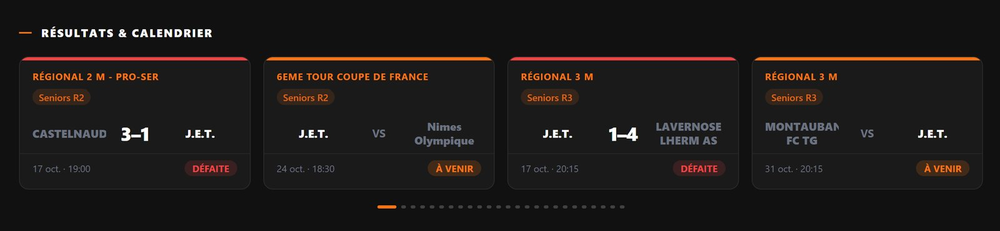
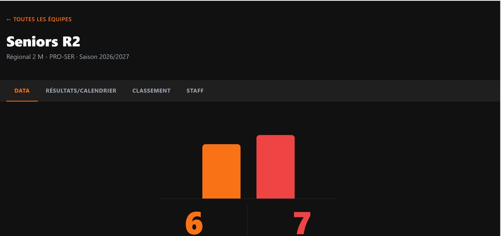
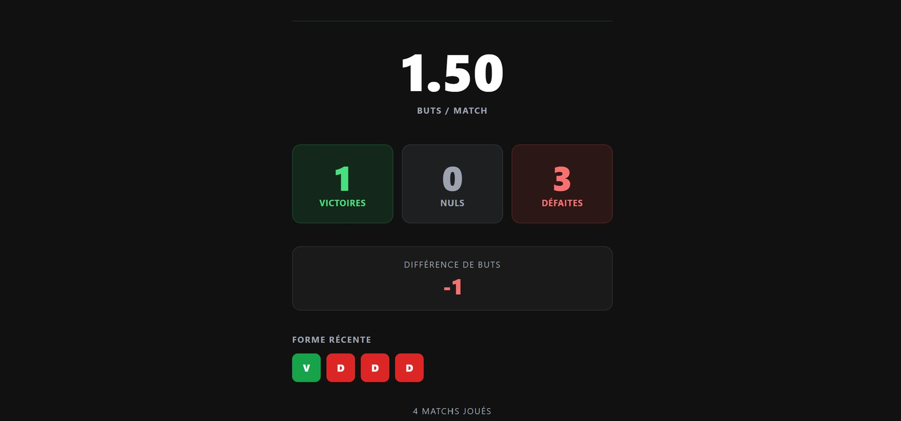
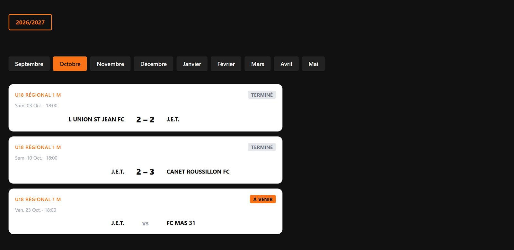
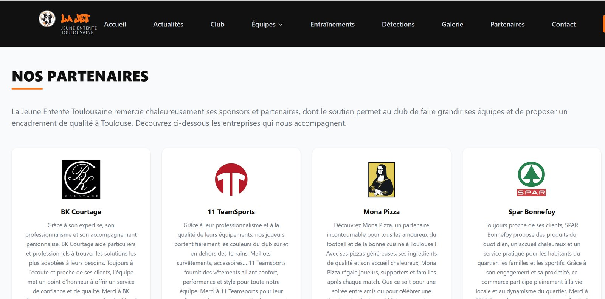
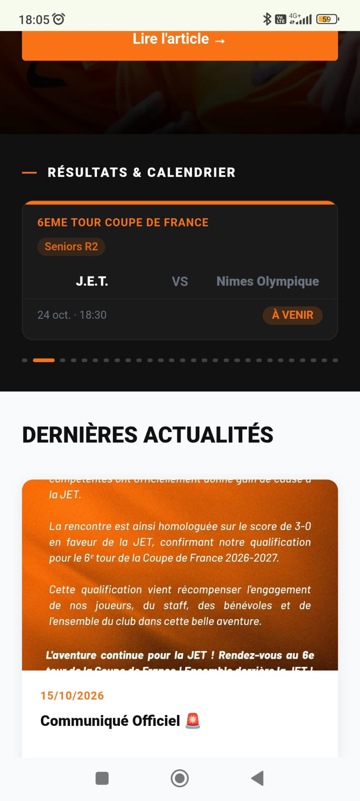
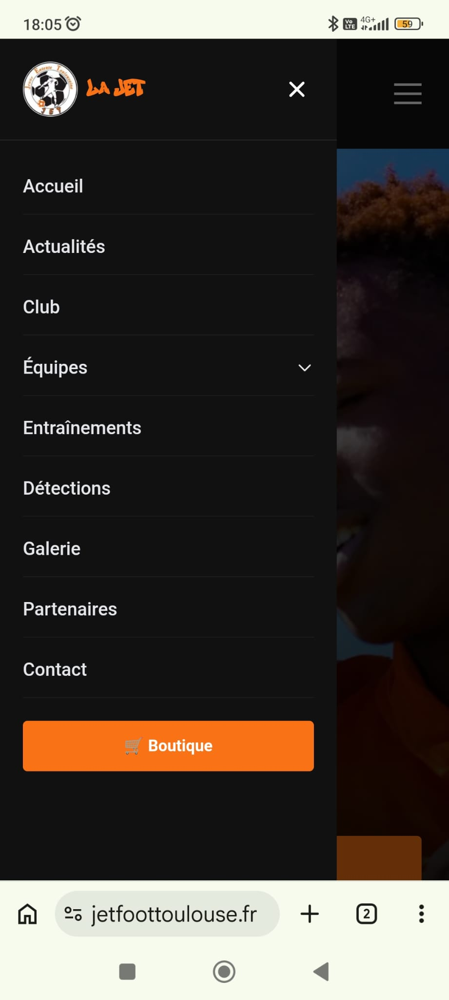
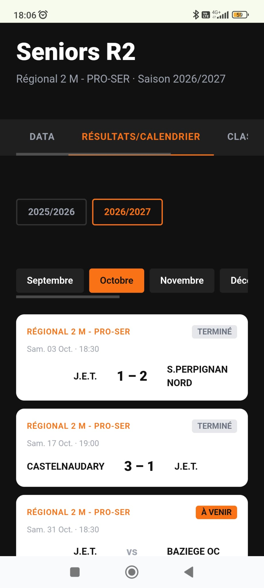
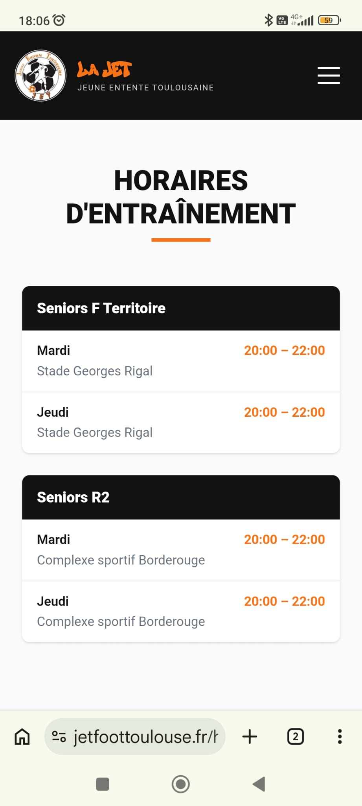

# Jeune Entente Toulousaine (JET)

Site web officiel du club de football **Jeune Entente Toulousaine** : vitrine du club, calendrier et résultats des matchs importés depuis la FFF, actualités, équipes, horaires d'entraînement et formulaire de contact.

Projet fullstack **Django + Next.js**, conteneurisé avec Docker.

## Aperçu

### Version desktop

<table>
  <tr>
    <td colspan="2"></td>
  </tr>
  <tr>
    <td colspan="2" align="center">Accueil – carrousel des résultats et prochains matchs</td>
  </tr>
  <tr>
    <td width="50%"></td>
    <td width="50%"></td>
  </tr>
  <tr>
    <td width="50%" align="center">Équipe – onglet DATA</td>
    <td width="50%" align="center">Équipe – bilan et forme récente</td>
  </tr>
  <tr>
    <td width="50%"></td>
    <td width="50%"></td>
  </tr>
  <tr>
    <td width="50%" align="center">Équipe – résultats / calendrier</td>
    <td width="50%" align="center">Partenaires</td>
  </tr>
</table>

### Version mobile

<table>
  <tr>
    <td width="25%"></td>
    <td width="25%"></td>
    <td width="25%"></td>
    <td width="25%"></td>
  </tr>
  <tr>
    <td width="25%" align="center">Carrousel des matchs</td>
    <td width="25%" align="center">Menu</td>
    <td width="25%" align="center">Équipe – résultats</td>
    <td width="25%" align="center">Entraînements</td>
  </tr>
</table>

---

## Fonctionnalités

### Site public
- **Accueil** : hero, carrousel des derniers résultats et prochains matchs (toutes catégories), dernières actualités, sponsors
- **Actualités** : liste et détail des articles (texte riche, image, vidéo)
- **Équipes** : Foot à 11, Foot à 8, Foot à 5, Futsal
  - Page détail avec 4 onglets : **DATA** (stats, forme), **RÉSULTATS / CALENDRIER**, **CLASSEMENT** (plus alimenté, voir « Contrainte : API FFF fermée »), **STAFF**
- **Horaires d'entraînement** par équipe
- **Détections** : formulaires d'inscription par catégorie (Google Forms intégrés)
- **Galerie photos** avec lightbox
- **Partenaires** : sponsors avec logos et liens
- **Club** : page de présentation
- **Contact** : formulaire envoyé directement par email (aucune donnée stockée)
- SEO : metadata sur chaque page, `sitemap.xml`, `robots.txt`
- Animations Framer Motion, design mobile-first noir/orange

### Administration (Django Admin, `/admin`)
- Articles (éditeur CKEditor), équipes, sponsors, galerie, détections, horaires
- **Joueurs & licences** (statut de paiement, montant, mode de paiement) — **jamais affichés publiquement**
- Paramètres du site (réseaux sociaux, boutique, email de contact)
- Compteur de visiteurs

### Automatisation
- **Scraping FFF** des résultats de toutes les équipes du club
- **Scheduler APScheduler** : 1 passage par jour en semaine, 6 passages le week-end (2h30 après chaque créneau de match)

### Contrainte : API FFF fermée

Depuis septembre 2026, l'API de la FFF (`api-dofa.fff.fr`) refuse les requêtes automatisées venant d'un serveur : elles sont bloquées par la protection anti-robots Akamai (erreur **403**). Le scraping automatique et le classement ne sont donc plus alimentés. Le code reste en place pour le jour où l'accès serait rétabli.

Le projet a été adapté en deux temps :

**1. Import du calendrier depuis les fichiers JSON de la FFF**

L'API répond toujours normalement quand on l'ouvre dans un vrai navigateur. Pour chaque équipe, on ouvre l'URL des matchs de la poule, on enregistre la réponse JSON telle quelle dans [`backend/club/fff_manual_imports/`](backend/club/fff_manual_imports/), puis on l'importe :

```bash
# depuis le dossier backend/
python manage.py import_fff_manual club/fff_manual_imports/2026-10-01-futsal-complet.json
```

La commande [`import_fff_manual`](backend/club/management/commands/import_fff_manual.py) accepte un ou plusieurs fichiers (ou du JSON collé directement dans la console du serveur). Elle réutilise la même logique de transformation que le scraping ([`fff_import.py`](backend/club/fff_import.py)) :
- elle ne garde que les matchs de la JET (un fichier de poule contient aussi les matchs entre les autres clubs) ;
- elle associe chaque match à la bonne équipe à partir de la catégorie FFF (U14, U15, Seniors…) ;
- elle met à jour un match déjà connu au lieu de créer un doublon (identifiant FFF `ma_no`) ;
- elle conserve la date initiale d'un match reporté.

Cela donne un calendrier complet pour la saison en quelques imports.

**2. Saisie des scores facilitée dans l'admin**

Comme les résultats n'arrivent plus automatiquement, l'admin Match a été repensé pour que le club saisisse les scores en quelques secondes :
- scores et statut **modifiables directement dans la liste**, sans ouvrir chaque match ;
- filtre **« match à mettre à jour »** : affiche uniquement les matchs passés sans score ;
- filtre **par saison** (août → juillet) et tri par date.

Les statistiques de l'onglet DATA (buts, victoires, forme) sont recalculées à partir de ces scores, elles restent donc à jour.

---

## Stack technique

| Couche | Technologies |
|---|---|
| Backend | Django 5.1, Django REST Framework, django-ckeditor, django-apscheduler |
| Base de données | PostgreSQL 16 |
| Scraping | Requests, BeautifulSoup4 |
| Frontend | Next.js 14 (App Router), TypeScript, Tailwind CSS, Framer Motion |
| Médias | Cloudinary |
| Email | django-anymail (Brevo) / SMTP |
| Infra | Docker, Docker Compose, Gunicorn, WhiteNoise |
| Déploiement | Railway (backend + PostgreSQL), Vercel (frontend) |

```
Navigateur ──► Next.js (frontend :3000) ──API REST──► Django (backend :8000) ──► PostgreSQL
                                                          ▲
                                          Django Admin ───┘   Scraping FFF (APScheduler)
```

---

## Structure

```
.
├── backend/                 # Django
│   ├── jet/                 # Projet (settings, urls)
│   ├── club/                # App principale
│   │   ├── models.py        # Article, Team, Player, Match, TeamStats, Sponsor...
│   │   ├── views.py         # API REST + contact + classement
│   │   ├── scheduler.py     # Planification du scraping
│   │   └── management/commands/
│   │       ├── scrape_fff.py
│   │       ├── refresh_classements.py
│   │       └── import_fff_manual.py
│   ├── requirements.txt
│   └── start.sh             # Démarrage production (migrate, collectstatic, gunicorn)
├── frontend/                # Next.js
│   ├── app/                 # Pages (App Router)
│   ├── components/          # Composants React
│   ├── lib/                 # Appels API, utilitaires
│   └── public/              # Logo, polices
├── docs/                    # Documentation par phase de développement
└── docker-compose.yml
```

---

## Installation en local

### Prérequis
- [Docker](https://docs.docker.com/get-docker/) et Docker Compose
- Git

### 1. Cloner le projet
```bash
git clone https://github.com/malik31200/Jeune-Entente-Toulousaine.git
cd Jeune-Entente-Toulousaine
```

### 2. Variables d'environnement
Créer un fichier `.env` à la racine (utilisé pour Cloudinary) :
```env
CLOUDINARY_CLOUD_NAME=...
CLOUDINARY_API_KEY=...
CLOUDINARY_API_SECRET=...
```
Les autres variables de développement (base de données, `DEBUG`, `SECRET_KEY`) sont déjà définies dans `docker-compose.yml`.

### 3. Lancer les conteneurs
```bash
docker compose up --build
```

### 4. Initialiser la base
```bash
docker compose exec backend python manage.py migrate
docker compose exec backend python manage.py createsuperuser
```

### 5. Récupérer les matchs FFF
```bash
# Import des fichiers JSON FFF (méthode actuelle, voir « Contrainte : API FFF fermée »)
docker compose exec backend python manage.py import_fff_manual club/fff_manual_imports/*.json

# Scraping automatique (bloqué par la FFF depuis septembre 2026)
docker compose exec backend python manage.py scrape_fff
```

### Accès
| Service | URL |
|---|---|
| Site | http://localhost:3000 |
| API | http://localhost:8000/api/ |
| Admin | http://localhost:8000/admin/ |

---

## API

Base : `/api/`

| Endpoint | Description |
|---|---|
| `articles/` | Actualités publiées |
| `teams/` | Équipes |
| `matches/` | Matchs (résultats et calendrier) |
| `team-stats/` | Statistiques d'équipe |
| `training-schedules/` | Horaires d'entraînement |
| `sponsors/` | Partenaires |
| `gallery/` | Photos de la galerie |
| `team-presentations/?category=foot-a-8` | Présentations Foot à 8 / Foot à 5 |
| `detections/` | Formulaires de détection actifs |
| `site-settings/` | Liens réseaux sociaux, boutique |
| `classement/?cp_no=&phase=&poule=` | Classement calculé depuis la FFF |
| `club-page/` | Contenu de la page Club |
| `contact/` (POST) | Envoi du formulaire de contact par email |

> Les joueurs (`Player`) ne sont **pas** exposés dans l'API.

---

## Commandes utiles

```bash
# Scraper les résultats FFF
docker compose exec backend python manage.py scrape_fff

# Rafraîchir les classements
docker compose exec backend python manage.py refresh_classements

# Créer une migration après modification des modèles
docker compose exec backend python manage.py makemigrations
docker compose exec backend python manage.py migrate

# Logs
docker compose logs -f backend
```

Pour afficher le classement d'une équipe, renseigner `cp_no`, `phase_no` et `poule_no` dans l'admin (fiche Équipe).

---

## Déploiement

**Backend (Railway)** — variables à définir :
`SECRET_KEY`, `DEBUG=0`, `DATABASE_URL`, `ALLOWED_HOSTS`, `CORS_ALLOWED_ORIGINS`, `CSRF_TRUSTED_ORIGINS`,
`CLOUDINARY_CLOUD_NAME`, `CLOUDINARY_API_KEY`, `CLOUDINARY_API_SECRET`,
`BREVO_API_KEY`, `DEFAULT_FROM_EMAIL`,
`DJANGO_SUPERUSER_USERNAME`, `DJANGO_SUPERUSER_PASSWORD`, `DJANGO_SUPERUSER_EMAIL` (optionnel, création auto de l'admin).

Le script `backend/start.sh` lance les migrations, `collectstatic` puis Gunicorn.

**Frontend (Vercel)** — variable à définir :
`NEXT_PUBLIC_API_URL` (ex. `https://<backend>/api`).

---

## Documentation

Le dossier [`docs/`](docs/) détaille chaque phase du développement (setup Docker, backend, frontend, design, SEO, animations).

---

## Auteur

**Malik Bouanani** — [GitHub](https://github.com/malik31200) · [LinkedIn](https://fr.linkedin.com/in/malik-bouanani-2282a636b)
